# oscar-ayala-pilas-java
Ejercicios de pilas en Java (omegaUp)

## Datos del estudiante
- **Nombre:** Oscar Manuel Ayala Ortiz
- **Grupo:** GTID244
- **Asignatura:** Estructuras de datos
- **Docente:** Gabriel Barrón Rodríguez
- **Fecha:** 16 de noviembre de 2026
- **Lenguaje:** Java, compilado y ejecutado por consola

## Ejercicios resueltos

| N.º | Problema | Estructura | Carpeta |
|---|---|---|---|
| 1 | Atestamiento del callejón | Pila | `ejercicio01_AtestamientoDelCallejon` |
| 2 | Conjunto | Pila | `ejercicio02_Conjunto` |
| 3 | EasyStack | Pila | `ejercicio03_EasyStack` |
| 4 | ()[]{}<> | Pila | `ejercicio04_ParentesisExtravagantes` |
| 5 | Las bitácoras de la sana distancia | Pila | `ejercicio05_BitacorasSanaDistancia` |
| 6 | Los Ultimos Seran Los Primeros | Pila | `ejercicio06_LosUltimosSeranLosPrimeros` |
| 7 | Máximo Elemento en la Pila | Pila con máximo | `ejercicio07_MaximoElementoEnLaPila` |
| 8 | Operaciones con una pila | Pila | `ejercicio08_OperacionesConUnaPila` |
| 9 | Paréntesis Balanceados | Pila | `ejercicio09_ParentesisBalanceados` |
| 10 | Paréntesis Regulares | Pila con arreglo | `ejercicio10_ParentesisRegulares` |
| 11 | Pila Interactivo | Pila | `ejercicio11_PilaInteractivo` |
| 12 | Sumando con pilas | Pila | `ejercicio12_SumandoConPilas` |
| 13 | Un banco con clientes no preferentes | Pila y cola | `ejercicio13_BancoClientesNoPreferentes` |

En todos se usa una pila propia (clase `Nodo` y clase `Pila`). No se usa Stack, ArrayDeque ni LinkedList de Java.

**Cómo funciona la pila propia:** solo se guarda la referencia al `tope`. Para apilar, el nodo nuevo apunta al tope actual y se vuelve el nuevo tope. Para desapilar, el tope baja al nodo de abajo. Las dos operaciones son O(1).

## 1. Atestamiento del callejón

**Problema:** el callejón tiene una sola entrada, así que el último auto en entrar es el primero en salir. Hay que decir cuántos autos se sacan para entregar el auto solicitado.

**Por qué pila:** el callejón funciona exactamente como una pila (LIFO).

**Algoritmo:** se apilan las placas en el orden de llegada. Luego se desapila contando hasta encontrar la placa solicitada; el conteo incluye al auto solicitado. Si la pila se vacía sin encontrarlo, se imprime "No existe el auto". Las placas se guardan como texto para no perder los ceros a la izquierda (012).

**Evidencia en omegaUp (100%):**

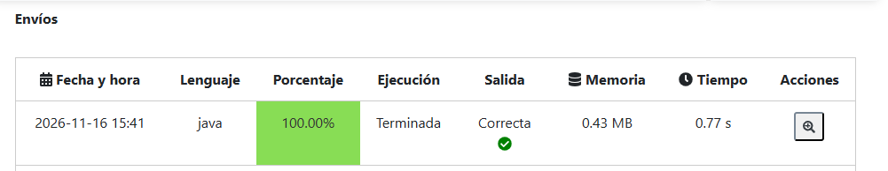

## 2. Conjunto

**Problema:** decir si una cadena solo tiene los caracteres a, b, c, d, ( y ) y si sus paréntesis están balanceados.

**Por qué pila:** cada ')' debe cerrar al último '(' que sigue abierto.

**Algoritmo:** cada '(' se apila. Con cada ')': si la pila está vacía, no está balanceada; si no, se desapila. Cualquier otro carácter que no sea a, b, c o d hace que la respuesta sea 0. Al final la pila debe quedar vacía.

**Evidencia en omegaUp (100%):**

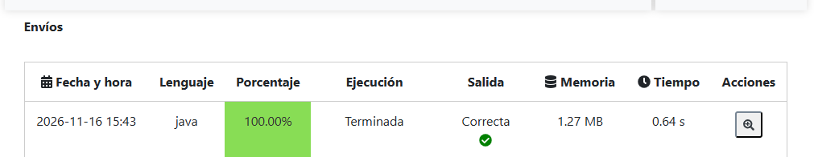

## 3. EasyStack

**Problema:** aplicar Push (1 n), Pop (2) y Top (3) sobre una pila de enteros.

**Algoritmo:** es la pila directa. En Pop, si la pila está vacía, no se hace nada. En Top, si está vacía, se imprime "Empty!". Se lee con `BufferedReader` porque puede haber 100,000 instrucciones.

**Evidencia en omegaUp (100%):**

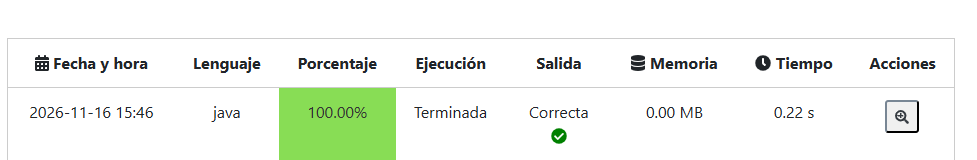

## 4. ()[]{}<>

**Problema:** encontrar el mínimo de reemplazos para que la cadena "tenga sentido", donde una apertura solo se cambia por otra apertura y un cierre por otro cierre.

**Por qué pila:** como no se puede cambiar una apertura por un cierre, las parejas ya están decididas: cada cierre va con la última apertura pendiente, que es el tope.

**Algoritmo:** se apilan las aperturas. Con cada cierre se desapila; si no son del mismo tipo, se suma 1 reemplazo. Es "imposible" si llega un cierre con la pila vacía o si al final sobran aperturas.

**Evidencia en omegaUp (100%):**

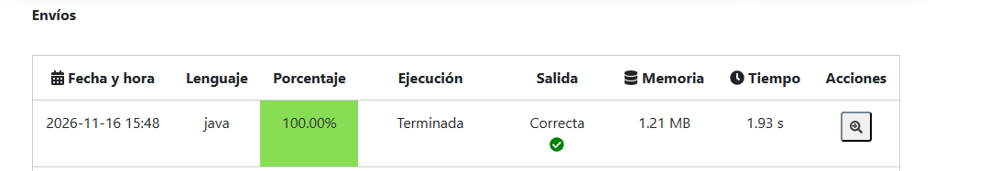

## 5. Las bitácoras de la sana distancia

**Problema:** cada minuto se pone un papelito encima de los demás y, cuando la telefonista está libre, toma el de hasta arriba. Hay que decir en qué orden se llamó a los teléfonos.

**Por qué pila:** los papelitos se acumulan uno encima de otro y siempre se toma el de arriba.

**Algoritmo:** se guarda el minuto en el que la telefonista vuelve a estar libre (`libreEnMinuto`, empieza en 1). En cada minuto primero se apila el papelito y, si `minuto >= libreEnMinuto`, se desapila uno y `libreEnMinuto = minuto + duración` de esa llamada. Cuando ya no llegan papelitos, se desapilan los que queden.

**Evidencia en omegaUp (100%):**

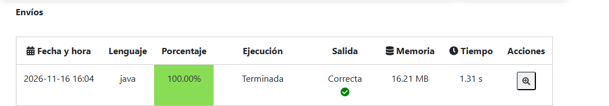

## 6. Los Ultimos Seran Los Primeros

**Problema:** imprimir a los concursantes al revés del orden en que llegaron.

**Algoritmo:** se apilan los nombres hasta leer "#" y luego se desapilan todos. Es el uso más básico de una pila: invertir el orden.

**Evidencia en omegaUp (100%):**

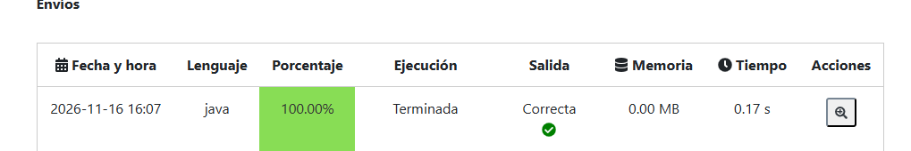

## 7. Máximo Elemento en la Pila

**Problema:** con 1 x se agrega, con 2 se borra el tope y con 3 se imprime el máximo de la pila.

**Por qué esta pila:** buscar el máximo recorriendo toda la pila en cada consulta sería muy lento (hasta 100,000 consultas). Por eso cada nodo guarda, además de su valor, el máximo que había en la pila al momento de apilarlo.

**Algoritmo:** al apilar x, el máximo del nodo nuevo es el mayor entre x y el máximo del tope anterior. Al desapilar, el máximo vuelve solo al del nodo de abajo. La consulta 3 solo lee el máximo del tope: O(1).

**Evidencia en omegaUp (100%):**

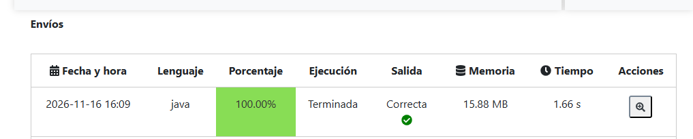

## 8. Operaciones con una pila

**Problema:** para cada número a, si la pila tiene menos de a elementos se mete a; si no, se sacan a elementos. Al final se imprime cuántos quedan y en qué orden saldrían.

**Algoritmo:** se compara `tamanio()` con a y se apila o se desapila a veces. Al final se imprime el tamaño y se desapila todo, que ya es el orden de salida.

**Evidencia en omegaUp (100%):**

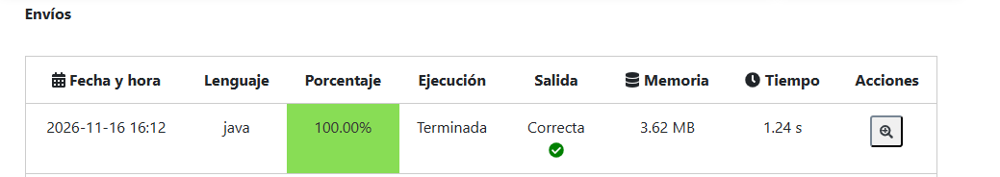

## 9. Paréntesis Balanceados

**Problema:** decir SI o NO para cada secuencia de ( ) [ ] { }.

**Algoritmo:** se apilan los que abren. Cada uno que cierra debe coincidir con el tope; si la pila está vacía o no coincide, es NO. Al final la pila debe quedar vacía.

**Evidencia en omegaUp (100%):**

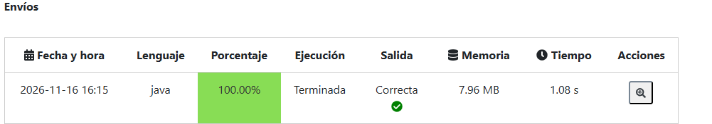

## 10. Paréntesis Regulares

**Problema:** encontrar la subcadena regular más larga y cuántas hay de ese largo. Si no hay ninguna, se imprime "0 1".

**Por qué pila con arreglo:** la cadena puede tener 1,000,000 de caracteres y el límite es de 32 MB. Un millón de objetos `Nodo` podría pasarse de memoria, en cambio un arreglo de `int` ocupa solo 4 bytes por elemento. Sigue siendo una pila propia (`PilaArreglo`), solo que guardada en un arreglo.

**Algoritmo:** en la pila se guardan **posiciones**. Se empieza apilando -1 como "base".
- Con '(' se apila su posición.
- Con ')' se desapila. Si la pila quedó vacía, ese ')' no tiene pareja y su posición se vuelve la nueva base. Si no, la subcadena regular que termina en i mide `i - tope`.

Se guarda el largo más grande y cuántas veces aparece. Además de las pruebas normales, se comparó contra una solución de fuerza bruta en 200 cadenas al azar y dio lo mismo en todas.

**Evidencia en omegaUp (100%):**

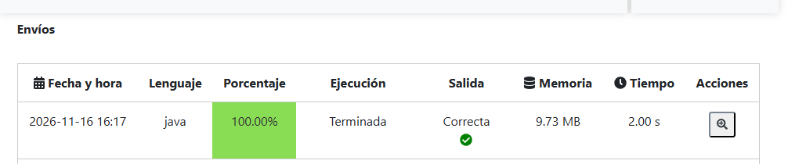

## 11. Pila Interactivo

**Problema:** implementar `agrega(n)` y `saca()`. Es interactivo: omegaUp llama a las funciones directamente y no hay que leer ni imprimir nada.

**Algoritmo:** `PilaInteractivo` tiene una `Pila` propia guardada como atributo `static`, para que se conserve entre llamadas. `agrega` apila y `saca` desapila, o devuelve -1 si la pila está vacía. `PruebaLocal.java` sirve solo para probarlo en la computadora: lee órdenes `agrega n` y `saca` y muestra lo que devuelve `saca()`.

**Evidencia en omegaUp (100%):**

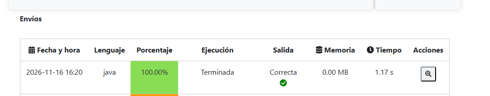

## 12. Sumando con pilas

**Problema:** AGREGA v apila v, CONSUME quita los dos últimos y apila su suma, e IMPRIME muestra el último.

**Algoritmo:** CONSUME hace dos `desapilar` y un `apilar` con la suma. Se usa `long` porque al sumar muchas veces el resultado puede pasarse del límite de `int`.

**Evidencia en omegaUp (100%):**

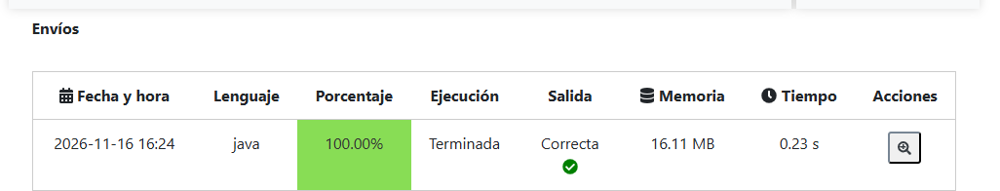

## 13. Un banco con clientes no preferentes

**Problema:** la fila 1 atiende primero al que llegó primero y la fila 2 atiende primero al que llegó al último. Hay que decir el orden en que se atendió a los clientes.

**Por qué pila y cola:** la fila 1 es una cola (FIFO) y la fila 2 es una pila (LIFO). Las dos son propias y usan el mismo `Nodo`.

**Algoritmo:** con "E fila nombre" se forma en la cola o se apila en la pila. Con "A fila" se atiende al frente de la cola o se desapila el tope de la pila.

**Evidencia en omegaUp (100%):**

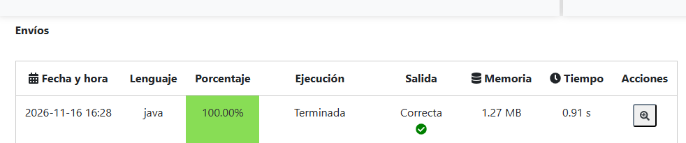

## Pruebas realizadas

Cada ejercicio se probó con los ejemplos de omegaUp y con casos propios: uno normal, uno límite y uno grande. En total pasaron **57 pruebas**.

| Ejercicio | Caso límite | Caso grande |
|---|---|---|
| 1 | N = 0 y placa con ceros a la izquierda | 10,000 autos |
| 2 | Cadena vacía | 100 caracteres |
| 3 | Pop con la pila vacía | 100,000 instrucciones |
| 4 | Cierre al inicio | 100,000 caracteres |
| 5 | N = 1 | 100,000 llamadas |
| 6 | Nadie antes de "#" | 2000 nombres |
| 7 | Un solo elemento | 100,000 preguntas |
| 8 | La pila queda vacía | 1000 números |
| 9 | Sobra un abierto | 1000 casos de 1000 caracteres |
| 10 | Sin subcadenas regulares | 1,000,000 de caracteres |
| 11 | Sacar con la pila vacía | — |
| 12 | N = 0 | Suma que no cabe en int |
| 13 | N = 0 | 10,000 eventos |

## Cómo compilar y ejecutar

Cada ejercicio está en su carpeta. Por ejemplo, para el ejercicio 1:

```
cd ejercicio01_AtestamientoDelCallejon
javac *.java
java Main
```

En el ejercicio 11 se ejecuta `java PruebaLocal`.

Después se escribe la entrada (o se pega). También se puede usar un archivo de entrada:

```
java Main < entrada.txt
```
